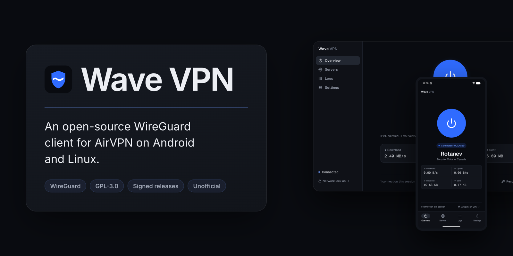
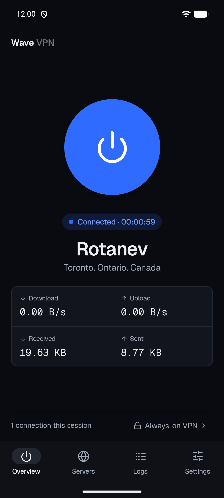
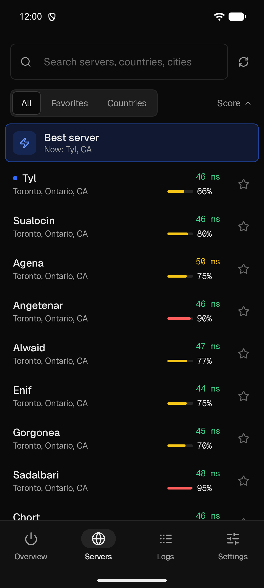

<p align="center">
  
</p>

<p align="center">
  <a href="https://github.com/VesselWave/wave-vpn-mobile/releases/latest"></a>
  <a href="LICENSE"></a>
  
</p>

An unofficial WireGuard client for [AirVPN](https://airvpn.org). Sign in with your AirVPN account, pick a server and connect: no config files to copy around. Open source, signed releases, and an honest account of what it protects and what it doesn't.

**[Download from vpn.vwave.me](https://vpn.vwave.me)** · [Release notes](docs/RELEASE-v0.1.1.md) · [Linux app](https://github.com/VesselWave/wave-vpn-desktop) · [Forum thread](https://airvpn.org/forums/topic/82017-wave-vpn-open-source-wireguard-client-for-android-and-linux-unofficial-v011/)

<p align="center">
  
  &nbsp;&nbsp;
  
</p>

- Sign in with your AirVPN account; each device gets its own WireGuard key
- Best-server choice, or search every server by name, country or city, with ping, load and favorites
- Split tunneling: route every app, bypass chosen apps, or tunnel only chosen apps
- Works with Android's Always-on VPN and Block connections without VPN
- Quick Settings tile, live traffic stats and connection log
- Choice of WireGuard port, and optional IPv6 server entry
- Credentials encrypted with Android Keystore and excluded from cloud backups

> [!NOTE]
> **Wave VPN is in early release.** Anyone is welcome to use it, but it hasn't been fully tested on every device and system yet.

## Setup

1. Download the APK from [vpn.vwave.me](https://vpn.vwave.me) and [verify it](#verify-your-download) (Android 8 or newer).
2. Open Wave VPN, sign in with your AirVPN username and password, and accept Android's VPN prompt.
3. Tap the power button. Wave VPN picks the best server; use **Servers** to choose another.
4. For the strongest protection, open **Settings → Open Android VPN settings** and turn on **Always-on VPN** and **Block connections without VPN**.

If you pressed Disconnect or the app was closed after repeated crashes, Android keeps blocking traffic while Wave VPN shows Disconnected. Open the app and tap Connect. More in [installation and support](docs/SUPPORT.md).

## Verify your download

Every release ships signed SHA-256 checksums. The release key is on [keys.openpgp.org](https://keys.openpgp.org/search?q=414018C0BBB8C0A70A80BF570AA32CCB2C0B3951) and [vpn.vwave.me](https://vpn.vwave.me/#verify):

```text
OpenPGP release key   4140 18C0 BBB8 C0A7 0A80  BF57 0AA3 2CCB 2C0B 3951
APK certificate       29:95:0A:57:56:87:67:59:B2:89:84:A0:E6:B4:4A:27:6E:FD:94:8F:8E:70:08:C3:FF:F4:71:D4:AD:41:88:21
```

```sh
gpg --recv-keys 414018C0BBB8C0A70A80BF570AA32CCB2C0B3951
gpg --verify wave-vpn-android-0.1.1-SHA256SUMS.asc wave-vpn-android-0.1.1-SHA256SUMS
sha256sum --ignore-missing -c wave-vpn-android-0.1.1-SHA256SUMS
apksigner verify --print-certs wave-vpn-android-0.1.1.apk
```

If any fingerprint differs from these, from [SECURITY.md](SECURITY.md) and from the website, don't install; report it privately. See [release signing](docs/RELEASE-SIGNING.md).

## Privacy

- Wave VPN talks only to AirVPN: its sign-in and server-list API, the WireGuard servers, and AirVPN's connection-check service. No analytics, ads or third-party trackers.
- Your username, password and account keys are stored on the phone, encrypted with Android Keystore, and never included in backups.
- The app keeps its log on the device. Nothing is uploaded.

## Building

Needs JDK 17 and Android SDK 37. Set `ANDROID_HOME` or put `sdk.dir=…` in `local.properties`.

```sh
./gradlew :core:test :app:lintDebug :app:assembleDebug
```

The debug APK installs as `me.vwave.vpn.dev`, next to a release install. The protocol layer lives in `core/` and follows AirVPN's official Eddie client; the UI is Kotlin and Jetpack Compose. More in [CONTRIBUTING.md](CONTRIBUTING.md); test evidence is indexed in [docs/](docs/README.md).

## How this was made

Most of Wave VPN's code, tests and documentation were written by AI coding agents, **Claude Opus 5.5** and **GPT 6.1 Sol**, working under the maintainer's direction. The maintainer sets the scope, makes the product and security decisions, provides the test devices, lab machines and AirVPN account, holds the signing keys, and decides what gets merged and released.

That's why everything is published: the source, the protocol references in [provenance](docs/PROVENANCE.md), and every [test report](docs/README.md), including the failures. Please judge the app by that evidence, not by who or what typed it, and report anything that looks wrong.

---

GPL-3.0-or-later. Independent project, not affiliated with or endorsed by AirVPN. Report security issues privately to **vesselwave@protonmail.com** ([security policy](SECURITY.md)).

## Published history privacy

The repository history and release packages were sanitized on 2026-11-03.
Lab records use example identities and addresses; private management details
are omitted. Sanitized release archives and fresh signed checksum manifests are
available. The APK and executable bytes are unchanged. Download the current
archives, checksums and signatures together. The GitHub repositories were
subsequently recreated under the same names without the old PR threads. Existing
clones may retain old history.
